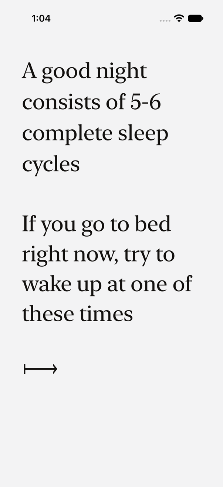
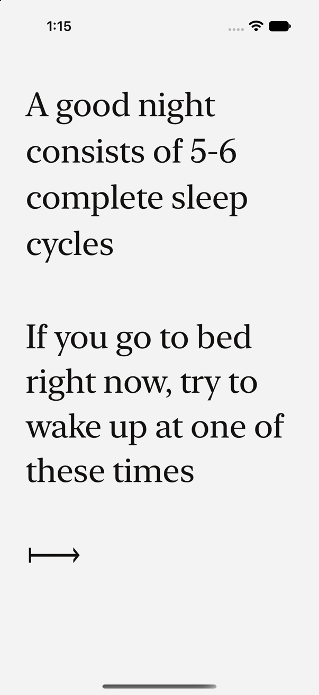
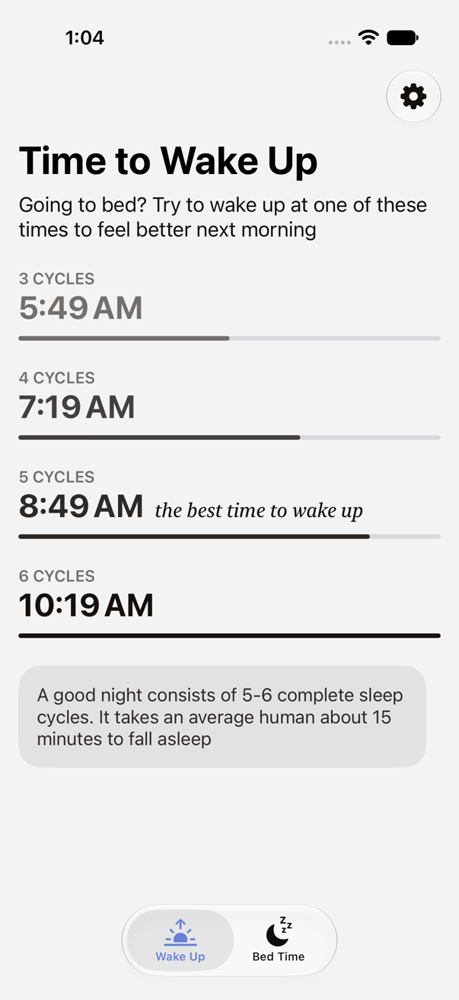
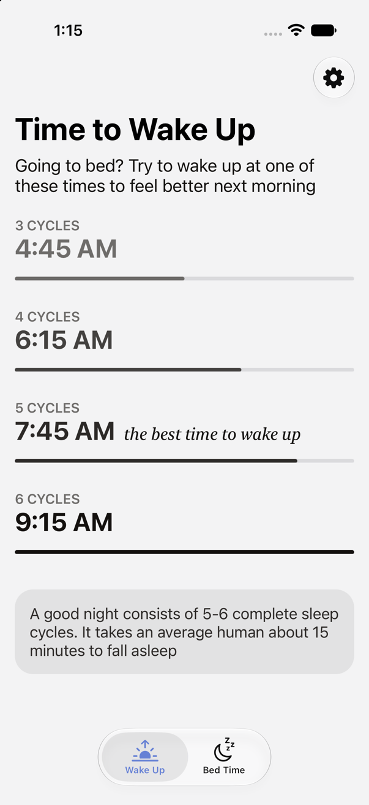
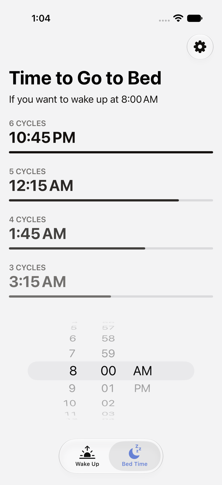
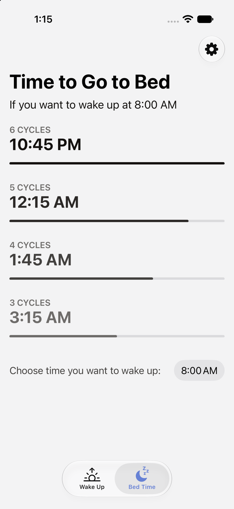
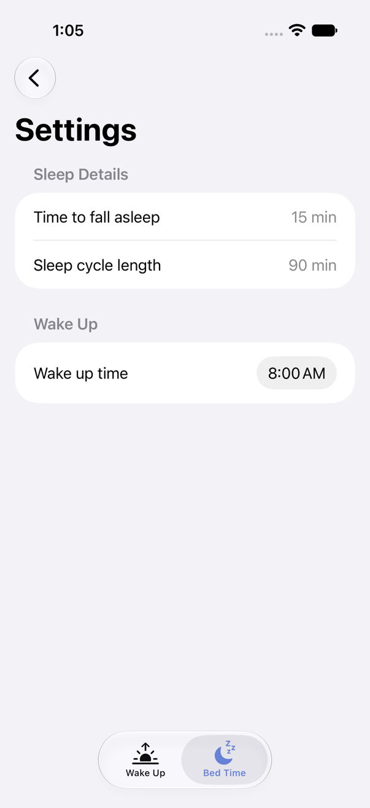
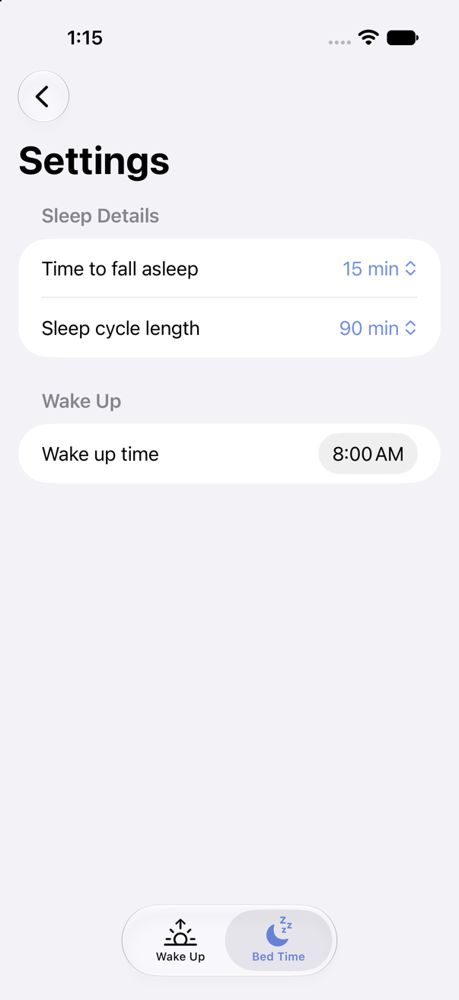

# LKM-649: the SwiftUI original and the Exact port, side by side

Both on the same iOS 27.2 Simulator (iPhone 17, light, English), shown at half the device's 3x pixels.
The original was driven by a throwaway XCUITest; the port by `bun exact.mjs agent ios --scale 3`.
The Wake Up times differ only because each app read a different "now": the original read the
simulator's clock, the port the agent's virtual clock.

| Screen | SwiftUI (original) | Exact (port) |
| --- | --- | --- |
| Intro |  |  |
| Wake Up |  |  |
| Bed Time |  |  |
| Settings |  |  |

Known differences:
- Bed Time's wake-up picker is UIKit's compact time pill. The original used SwiftUI's wheel, but Exact's
  `input type="time"` draws only the compact `UIDatePicker`.
- Settings' minute pickers are pop-up menus (`select`), not the original's wheel in a bottom overlay.
- TextColor4's light side is #6e6c6a, not #72706e, for 4.5:1 contrast on the background.
- Text sizes are in rem, so they follow Dynamic Type; the original's were fixed.
